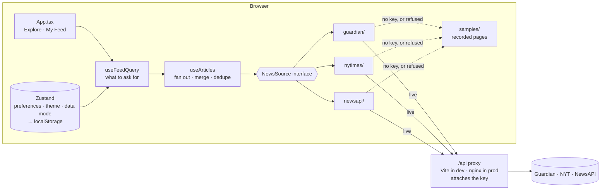

# Newsstand — News Aggregator

A news aggregator built for the innoscripta Frontend Developer case study. It searches and filters
articles across **The Guardian**, **The New York Times** and **NewsAPI.org**, merges them into one
deduplicated feed, and lets a reader personalise that feed by source, category and author.

React 19 · TypeScript (strict) · Vite 8 · TanStack Query · Zustand · Tailwind CSS 4 · nginx

|                  |                                                                                |
| ---------------- | ------------------------------------------------------------------------------ |
| **Run it**       | `docker compose up --build` → <http://localhost:8080> (no API keys needed)     |
| **Providers**    | Guardian · NYT Article Search · NewsAPI.org, behind one `NewsSource` interface |
| **Keys**         | Server-side only — never in the bundle, never in an image layer                |
| **Tests**        | 154 across 16 files; 90% statements, 92% lines                                 |
| **Bundle**       | 133 kB gzipped JS, 8 kB gzipped CSS                                            |
| **Runtime deps** | 9, no UI framework beyond Radix Dialog                                         |

---

## Contents

- [What it does](#what-it-does)
- [Quick start](#quick-start)
- [API keys and configuration](#api-keys-and-configuration)
- [Architecture](#architecture)
- [Provider integration](#provider-integration)
- [Search, filters and personalisation](#search-filters-and-personalisation)
- [Data modes: Auto, Live, Demo](#data-modes-auto-live-and-demo)
- [Loading, empty and error states](#loading-empty-and-error-states)
- [Quota discipline and performance](#quota-discipline-and-performance)
- [Docker](#docker)
- [Testing](#testing)
- [Design system, mobile and accessibility](#design-system-mobile-and-accessibility)
- [Known limitations and trade-offs](#known-limitations-and-trade-offs)
- [Troubleshooting](#troubleshooting)
- [Where this would go next](#where-this-would-go-next)

---

## What it does

**Two feeds, one screen.** A segmented control switches between **Explore** (search the three
providers with filters) and **My Feed** (only your saved sources, categories and authors).

- **Search** — one keyword box, debounced 400 ms, sent to every selected provider in parallel.
- **Filters** — source, category (7 canonical values) and an inclusive date range. Every applied
  filter appears as a removable chip above the results, with "Clear all".
- **Personalisation** — preferred sources, categories and authors, saved to `localStorage`.
  Authors can be picked from contributors already present in the loaded feed instead of typed
  from memory. With nothing saved, My Feed asks for choices rather than serving the unfiltered
  feed under a personalised label.
- **One merged feed** — all providers fetched in parallel, normalised to a single `Article` model,
  deduplicated by canonical URL and by headline within a 48-hour window, sorted newest first.
- **Browsing** — Previous/Next pages, or infinite scroll that holds your reading position when a
  newly loaded page merges into the middle of the list.
- **Resilience** — a rate-limited or failing provider becomes a notice while the others still
  render; only a total failure shows an error state. Every provider can also fall back to a
  recorded sample, so the app is fully usable with no API keys at all.
- **Presentation** — light / dark / system theme, responsive from 320 px, keyboard accessible.

**Not implemented:** there is no router and no URL state, so a search cannot be shared as a link
and Back does not step through filter changes. See [limitations](#known-limitations-and-trade-offs).

---

## Quick start

### Docker — no keys required

```bash
docker compose up --build
```

Open <http://localhost:8080>. With no `.env.local` present, every provider serves its recorded
sample and a notice above the feed says so, per provider, naming the reason. Search, filters,
personalisation and both browsing modes all work against that sample.

To use live data, add keys first (see [configuration](#api-keys-and-configuration)):

```bash
cp .env.example .env.local      # then fill in the three values
docker compose up --build
```

Without Compose:

```bash
docker build -t newsstand .
docker run --rm -p 8080:8080 --env-file .env.local newsstand
```

Keys are read at **container start**, not at build time, so the image contains no credentials and
can be rebuilt or shared without leaking them.

### Local development

Requires **Node 22** (the version the Dockerfile and CI use).

```bash
npm install
cp .env.example .env.local      # optional — without it, providers serve samples
npm run dev                     # http://localhost:5173
```

### Scripts

| Script               | What it does                                 |
| -------------------- | -------------------------------------------- |
| `npm run dev`        | Vite dev server with the API proxy           |
| `npm run build`      | `tsc -b` then the production bundle          |
| `npm run preview`    | Serves the built bundle (see the note below) |
| `npm run test`       | Vitest, single run                           |
| `npm run test:watch` | Vitest in watch mode                         |
| `npm run lint`       | ESLint                                       |
| `npm run format`     | Prettier, write mode                         |

Two useful commands have no script of their own:

```bash
npx tsc -b                  # type check only
npx vitest run --coverage   # coverage report
```

> **`npm run preview` has no provider proxy.** The upstream proxy table is registered under Vite's
> `server` config, not `preview`, so a previewed build can reach `/api/status` but not the
> providers. Preview is fine for checking the bundle in Demo mode; use Docker to exercise the
> production path with live data.

---

## API keys and configuration

All three keys are free and self-serve. Put them in `.env.local` (git-ignored and
Docker-ignored); `.env.example` lists them with links.

| Variable       | Where to get it                                                                       | Free tier                       |
| -------------- | ------------------------------------------------------------------------------------- | ------------------------------- |
| `GUARDIAN_KEY` | [open-platform.theguardian.com/access](https://open-platform.theguardian.com/access/) | 5,000/day, 12/sec               |
| `NYT_KEY`      | [developer.nytimes.com](https://developer.nytimes.com/) — the API key, not the secret | 500/day, **5/min**              |
| `NEWSAPI_KEY`  | [newsapi.org/register](https://newsapi.org/register)                                  | **100/day**, 24 h article delay |

**Every key is optional.** A blank or absent key puts that provider on its recorded sample; the
other two still run live. This is why there is no `VITE_` prefix anywhere in the list — these are
read by the Node dev server and by nginx, never by client code, and they never enter the bundle.

### The proxy

The browser only ever calls same-origin paths:

| Path                          | Forwards to                                            |
| ----------------------------- | ------------------------------------------------------ |
| `/api/status`                 | nothing — reports which keys are set, as booleans only |
| `/api/guardian/search`        | `content.guardianapis.com/search`                      |
| `/api/nyt/articlesearch.json` | `api.nytimes.com/svc/search/v2/articlesearch.json`     |
| `/api/newsapi/everything`     | `newsapi.org/v2/everything`                            |
| `/api/newsapi/top-headlines`  | `newsapi.org/v2/top-headlines`                         |
| anything else under `/api/`   | 404                                                    |

Two reasons for the proxy, not one:

1. **NewsAPI.org sends no CORS headers at all** and permits localhost origins only, so a deployed
   page cannot call it directly however the key is handled.
2. **Keys stay server-side.** They never reach the JS bundle and never appear in DevTools.

The same paths work in both environments — dev via Vite's `server.proxy` ([`vite.config.ts`](vite.config.ts)),
production via nginx ([`nginx.conf.template`](nginx.conf.template)).

In production each endpoint is matched **exactly** (`location =`). A prefix match would turn the
container into an open relay: anyone who could reach it could spend the key on any path those hosts
expose. nginx also caches successful responses for 5 minutes with the credential excluded from the
cache key, so the cache is shared across tabs and readers rather than per-session.

---

## Architecture



There is no backend of my own: nginx serves the static bundle and proxies the three providers.
The aggregation happens in the browser.

### How a request flows

1. **`useFeedQuery`** ([`src/hooks/useFeedQuery.ts`](src/hooks/useFeedQuery.ts)) turns UI state into
   one `ArticleQuery`. In Explore that is the component's own filter state; in My Feed it is the
   saved preferences. The keyword is debounced here, and every setter returns to page 1.
2. **`useArticles`** ([`src/hooks/useArticles.ts`](src/hooks/useArticles.ts)) issues **one TanStack
   query per source per page** — not one combined query — so a failing provider cannot take the
   others down with it. Cache keys sort their arrays, so picking two categories in a different
   order is a cache hit rather than three fresh requests.
3. **Each adapter** ([`src/sources/<provider>/`](src/sources)) translates the query into that API's
   parameters, calls it through the shared transport, and maps the response into the canonical
   `Article`.
4. **`useArticles` folds the results back together**: it re-applies in the browser every filter a
   provider declared it could not honour, merges the per-source lists, dedupes, sorts newest first,
   and collects per-source failures, caveats and delivery origins for the UI to state.

### Folder structure

```
src/
  domain/          Framework-agnostic contracts — no React, no fetch
    article.ts       Article · Category · SourceId
    query.ts         ArticleQuery · ArticlePage · cache keys
    news-source.ts   NewsSource port · SourceCapabilities · FetchContext · NewsSourceError
  sources/
    registry.ts      The single extension point
    http.ts          Shared transport: timeout, cancellation, status→error mapping
    demo.ts          Recorded-sample delivery and the rate-limit circuit breaker
    guardian/        adapter · mapper · types   (same three files per provider)
    nytimes/
    newsapi/
  samples/         Recorded provider responses — production data, borrowed by the tests
  hooks/
    useArticles.ts       Fan out, merge, dedupe, client-side filter fallbacks
    useFeedQuery.ts      Everything that decides what to ask for
    useSourceAvailability.ts  Reads /api/status once, for Auto mode
  features/        feed · search · preferences · settings · data-mode
  components/ui/   Button · Chip · Toggle · SegmentedControl · Section · Dialog
  store/           Persisted preferences, theme, data mode (Zustand)
  app/             App shell, providers, ErrorBoundary
  lib/             dedupe · dates · text · authors · cn
```

Dependencies point one way: `app → features → hooks → sources → domain`. `domain/` imports nothing
from the rest of the app, and nothing outside `src/sources/<provider>/` knows any provider's wire
format.

### The `NewsSource` port

Every provider implements one interface ([`src/domain/news-source.ts`](src/domain/news-source.ts)).
**Adding a fourth provider** means writing one folder, appending one line to
[`src/sources/registry.ts`](src/sources/registry.ts), and adding its upstream to the two proxy
tables. No hook, feature or component changes.

The proxy tables are the honest caveat: `vite.config.ts` and `nginx.conf.template` describe the same
routing in two languages, because dev and production route the same URLs through different
software. That is the one place the open/closed property does not hold.

### `SourceCapabilities` is a function of the query

```ts
capabilities(query: ArticleQuery): SourceCapabilities
```

It takes the query because for two of the three providers the honest answer depends on what else was
asked for: NewsAPI supports a date range on `/everything` but not on `/top-headlines`, so the same
provider answers differently for two queries that differ only by category. A static boolean could
only have been right about one of them.

Every `false` is then honoured by `applyClientSideFilters` in `useArticles`, which re-applies that
predicate in the browser. **The flags are behaviour, not documentation** — if the category flag were
ignored, the NYT would contribute off-category articles to every filtered feed, and a test asserts
that it does not.

Where a provider simply does not _have_ the articles — NewsAPI's one-category-per-request limit —
`capabilities` returns a `caveat` string instead, and the UI states it rather than leaving the feed
looking mysteriously thin.

---

## Provider integration

### Why these three sources

The brief lists seven. Only three are usable today:

| Listed source                      | Status                                                                                 |
| ---------------------------------- | -------------------------------------------------------------------------------------- |
| NewsAPI (#1) and NewsAPI.org (#7)  | The same service, listed twice                                                         |
| OpenNews                           | `opennews.org` is a journalism nonprofit; `api.opennews.org` does not resolve          |
| NewsCred                           | Absorbed into Optimizely; `newscred.com` redirects there and the public API is retired |
| BBC News                           | No public API — BBC's own is internal. RSS only                                        |
| **The Guardian, NYT, NewsAPI.org** | **Live, documented, free tiers**                                                       |

### What each provider will actually filter

This is the single most important thing I learned building against these APIs, and it drives the
design. **Two of the three cannot apply the filters their documentation advertises**, and both fail
silently — an unfiltered or empty result set looks exactly like a legitimate one.

|            | Guardian               | NYT                  | NewsAPI.org                     |
| ---------- | ---------------------- | -------------------- | ------------------------------- |
| Keyword    | yes, archive to 1999   | yes, archive to 1851 | yes, ~1 month                   |
| Category   | yes (`section`)        | **no** (see below)   | one at a time, `/top-headlines` |
| Date range | yes                    | yes                  | `/everything` only              |
| Author     | yes (contributor tags) | **no** (see below)   | **no**                          |
| Page size  | honours ours (12)      | fixed 10             | honours ours (12)               |
| CORS       | `*`                    | `*`                  | **none — localhost only**       |

#### The NYT `fq` parameter returns nothing

Article Search documents a Lucene `fq` for filtering by news desk, section and byline. Measured
against the live API with a valid key, same minute, HTTP 200 on every call:

```
q=climate                              →  10,000 hits
q=climate & fq=news_desk:("Climate")   →       0 hits, docs: null
fq=news_desk:("Foreign")               →       0 hits   (desk is present in the data)
fq=section_name:("World")              →       0 hits
fq=document_type:("article")           →       0 hits   (trivially true filter)
fq=glocations:("Iraq")                 →       0 hits   (NYT's own documentation example)
```

Any `fq` empties the result set, including filters that cannot possibly match nothing. Sending it
would drop the NYT out of every filtered feed. So the adapter does not send it: `nytimesSource`
declares `categoryFilter: false` and `authorFilter: false`, and those filters are applied in the
browser instead. `begin_date`/`end_date` are unaffected and still go upstream.

#### NewsAPI splits filters across two incompatible endpoints

|            | `/everything`           | `/top-headlines`     |
| ---------- | ----------------------- | -------------------- |
| keyword    | yes, full archive       | yes, headlines only  |
| category   | **no parameter at all** | yes, one at a time   |
| date range | yes                     | **silently ignored** |

A keyword therefore cannot be allowed to decide the endpoint. If a category is selected the request
goes to `/top-headlines` and the keyword rides along; the corpus is smaller, but a narrow correct
result beats a broad wrong one. The date range is then applied in the browser, and if more than one
category is selected the UI says that NewsAPI contributed only the first — that is missing coverage,
not a filter the browser can re-apply.

### Normalisation

Each adapter maps its provider's payload into one `Article`
([`src/domain/article.ts`](src/domain/article.ts)): id, title, description, url, optional image,
ISO timestamp, optional author, optional category, and `source: { id, name }`.

- **Categories** are mapped onto NewsAPI's seven canonical values, because they are the narrowest
  set and make provider → canonical a total function. Each mapper holds one table and _derives_ its
  reverse lookup, so the two directions cannot drift apart — a test asserts this. Unmapped sections
  fall back to `general`.
- **Bylines** differ: the NYT prefixes `"By "`, the Guardian prefers contributor tags over
  `fields.byline`. `normaliseAuthor` folds them to one comparable form.
- **Summaries are stripped of HTML**, never rendered. Third-party content never reaches
  `dangerouslySetInnerHTML`.
- **Deduplication** ([`src/lib/dedupe.ts`](src/lib/dedupe.ts)) collapses a URL match outright, and a
  headline match only within a 48-hour window — otherwise a recurring headline ("Morning briefing")
  would collapse months of coverage into one card. NewsAPI syndicates outlets the other two publish
  directly, so this fires in practice.
- **Articles are typed, not schema-validated.** See [limitations](#known-limitations-and-trade-offs).

---

## Search, filters and personalisation

- **Search** is one input, debounced 400 ms, applied to every selected provider. It is a rate-limit
  defence as much as a UX one: the NYT allows five requests a minute.
- **Applied filters are stated where the results are.** Each selected source, each category, and the
  date range as one entry, as removable chips above the feed. The controls themselves are in a
  sidebar on desktop and behind a sheet on a phone, so without the chips the narrowest layout would
  show only a count on a button. The whole chip is the control rather than a nested ✕, keeping the
  target at 40 px. "Clear all" resets the filters and deliberately leaves the keyword alone — the
  search box is its own control.
- **Explore vs My Feed.** Explore's filters live in component state and reset on reload. My Feed's
  are the saved preferences, and it carries no date range: a standing set of interests is not a
  point-in-time search, and a stale range would quietly hide new articles.
- **Author suggestions.** Author matching only works on names the providers actually publish —
  "Fiona Harvey" matches, "F. Harvey" matches nothing — so Personalise lists contributors found in
  pages already in the TanStack cache, ranked by frequency. Nothing is fetched for it; an
  autocomplete that spent NewsAPI's 100 daily requests would be a poor trade.
- **Preferences persist** to `localStorage` under `newsstand.preferences.v1`, and are **validated on
  rehydration**. That store is the one input the app does not write itself: it outlives deploys, is
  shared with every tab, and can be hand-edited. An unknown source id in it would reach `getSource`,
  which throws, blanking the page before first render. `sanitizePreferences` narrows the stored value
  field by field, so one bad entry is dropped rather than the whole saved state.

---

## Data modes: Auto, Live and Demo

**Settings** (the gear in the header) offers all three, alongside the Pages/Infinite choice.

| Mode     | Behaviour                                                                                                                                                                                                                                                                    |
| -------- | ---------------------------------------------------------------------------------------------------------------------------------------------------------------------------------------------------------------------------------------------------------------------------- |
| **Auto** | Default. Calls a provider when its key is set; serves that provider's sample, with no request, when the key is blank. If a live call comes back rate-limited or rejected, it substitutes the sample, says why, and does not call that provider again until the mode changes. |
| **Live** | Always calls the APIs. A failure stays a failure.                                                                                                                                                                                                                            |
| **Demo** | Never calls the news APIs at all.                                                                                                                                                                                                                                            |

`GET /api/status` reports which keys are configured — booleans only, the keys stay on the server —
and Auto reads it once before deciding.

The sample is the recorded set under [`src/samples/`](src/samples): one page per provider endpoint.
Keyword, category, date and author are applied to it **in the browser**, so a search only shows
sample stories that match; it cannot find anything outside the recording. Whenever any provider is
on its sample the gear carries a dot and a notice above the feed names which and why — moving the
control into a dialog must not move the disclosure there too.

The samples double as the fixtures the mapper tests run against, so UI work never spends NewsAPI's
100-request daily budget.

---

## Loading, empty and error states

Every state the feed can be in is modelled explicitly rather than falling out of a spinner:

| State                       | What the reader sees                                                                                               |
| --------------------------- | ------------------------------------------------------------------------------------------------------------------ |
| First load                  | Card skeletons matching the grid, `aria-busy`                                                                      |
| Refining an existing search | The current feed stays on screen (`keepPreviousData`) with a spinner in the search box — no teardown to a skeleton |
| One or two providers failed | A warning notice naming each, with the reason; the rest of the feed renders                                        |
| Every provider failed       | A distinct error state listing each failure                                                                        |
| No sources selected         | A prompt to pick at least one                                                                                      |
| My Feed, nothing saved      | A prompt to personalise — and no request is sent                                                                   |
| No matches                  | An empty state with "Clear all filters"                                                                            |
| Infinite scroll, page cap   | "Showing the first 25 pages. Narrow the search to see more."                                                       |
| A render-time throw         | `ErrorBoundary` — "Try again", plus a reset of saved choices                                                       |

Failures are classified once, in the transport layer, into `rate-limited | auth | network | unknown`
and rendered from a single `NewsSourceError.describe(label)`, so no component branches on a
provider-specific error shape. NewsAPI reports rate limits and bad keys as **HTTP 200 with
`status:"error"`**, which the shared transport cannot see, so its adapter classifies those itself.

The error boundary offers a reset of saved preferences specifically because those outlive the
session — they are the one input that can reproduce a crash on every reload.

---

## Quota discipline and performance

The NYT's 5 requests/minute and NewsAPI's 100/day are the tightest constraints in the project, and
four decisions follow from them:

1. **Debounced search** (400 ms) — one request per settled keyword, not per keystroke.
2. **Long cache windows** — `staleTime` 5 min, `gcTime` 30 min, no refetch on focus or reconnect.
3. **No retry on 4xx** — retrying a 429 or a rejected key only spends more of the budget.
4. **A shared cache in nginx** — the client cache is per tab, which does nothing for a second tab, a
   refresh, or a second reader. `proxy_cache` holds responses for 5 minutes, matching `staleTime` so
   both layers expire together, and its key excludes the credential so everyone shares one entry.

**Infinite scroll is not a second data path.** Browsing by pages asks for page _N_; infinite scroll
asks for pages _1…N_. Every page but the newest is already in the TanStack cache, so re-requesting
them costs nothing and no request leaves the browser. There is no accumulator in component state, no
refs mirroring state and no effect to keep them in step — the rendered list is derived from the
cache, so it cannot drift out of sync with it. Scrolling is capped at 25 pages and the UI says so.

**Merged pages reorder, so the viewport is re-anchored.** Pages are sorted by recency across
providers, and NewsAPI's 24-hour delay means page 2 of a live provider can land _above_ page 1 of a
lagging one — pushing the card being read down the screen. `ReadingAnchor` measures the first card
below the sticky header immediately before the new list commits, then scrolls by however far it
moved. It is a class component because `getSnapshotBeforeUpdate` has no hook equivalent, and a
cached scroll position cannot stand in for it: lazily loaded images resize cards between scroll
events, so a position recorded earlier is stale by the time the merge lands.

**Bundle**, from `npm run build`:

| Asset | Raw    | gzip       |
| ----- | ------ | ---------- |
| JS    | 425 kB | **133 kB** |
| CSS   | 41 kB  | 8 kB       |

One chunk — there is one screen and no routing, so there is nothing meaningful to split. Fonts are
self-hosted (Latin and Latin-Extended subsets only) so the container has no third-party runtime
dependency.

---

## Docker

```bash
docker compose up --build              # picks up .env.local if it is there
HOST_PORT=8090 docker compose up       # when 8080 is already taken
```

The image is a two-stage build: `node:22-alpine` compiles and bundles, then
`nginxinc/nginx-unprivileged:alpine` serves. Nothing runs as root. A `HEALTHCHECK` polls the app
over `127.0.0.1` — not `localhost`, because nginx binds IPv4 only while busybox `wget` resolves
`localhost` to `::1` first and fails against a perfectly healthy container.

**It boots with no keys at all.** Files under `/etc/nginx/templates` are run through `envsubst` by
the image's entrypoint at container start, which is how keys arrive as runtime environment variables
rather than being baked in. `envsubst` only substitutes variables that _exist_, so an undefined
`GUARDIAN_KEY` would leave a literal `${GUARDIAN_KEY}` in the config and nginx would refuse to start.
[`docker/15-api-key-defaults.envsh`](docker/15-api-key-defaults.envsh) is sourced before the
substitution step and defines the three as empty, which keeps the keyless path working without
putting any key name or value into an image layer. `.env.local` is declared optional in
[`docker-compose.yml`](docker-compose.yml) for the same reason.

CI builds the image and asserts that a container with **no API keys** comes up and serves.

---

## Testing

```bash
npm run test                # 154 tests across 16 files
npx vitest run --coverage   # 90% statements · 92% lines
```

Verified on the current tree: 154 passing, ESLint clean, `tsc -b` clean, production build clean.

| Layer                           | What is covered                                                                                                                                                                                                                                                                                                                                                                         |
| ------------------------------- | --------------------------------------------------------------------------------------------------------------------------------------------------------------------------------------------------------------------------------------------------------------------------------------------------------------------------------------------------------------------------------------- |
| **Mappers** (3 files)           | Run against **recorded live API responses**, not hand-written guesses. This caught two real discrepancies: the NYT's current `multimedia` field is an object of renditions with absolute URLs rather than the array of relative paths most documentation describes, and `response.docs` is `null` — not `[]` — on a zero-hit query, which is why the wire type says `NytDoc[] \| null`. |
| **Adapters**                    | Assert the exact upstream URL built from a given `ArticleQuery` — including NewsAPI's switch between `/everything` and `/top-headlines`, which callers never see, and the absence of any `fq` on NYT requests.                                                                                                                                                                          |
| **Data modes** (`demo.test.ts`) | The Auto fallback, the rate-limit circuit breaker, and that Demo sends no requests at all.                                                                                                                                                                                                                                                                                              |
| **Pure logic**                  | Dedupe, author collection, applied-filter labelling, client-filter disclosure, the reading-anchor geometry.                                                                                                                                                                                                                                                                             |
| **Stores**                      | Preference sanitisation against corrupt `localStorage`, and the three-way theme including blocked storage.                                                                                                                                                                                                                                                                              |
| **App** (30 tests)              | Search debouncing, every filter, per-source failure, the Auto/Live/Demo round trip, the Settings dialog, preference persistence — through the real adapters, with only `fetch` replaced.                                                                                                                                                                                                |

Two things make these tests worth more than their count:

**Filters are asserted on the results, not just the request.** Selecting a category must remove
off-category articles from the rendered feed, _including from the provider that cannot filter
upstream_. Asserting only the outgoing URL cannot distinguish a provider that filtered from one that
ignored the filter — and that gap is exactly where two silent bugs lived.

**The fake honours its parameters.** [`src/test/mock-api.ts`](src/test/mock-api.ts) applies
`section`, `q`, dates and contributor tags the way each provider applies them upstream — and
deliberately ignores `fq`, because the real API does. A fake that returns the same page whatever it
is asked makes every filter test pass by accident.

[`.github/workflows/ci.yml`](.github/workflows/ci.yml) runs lint, the type check, the suite and a
production build on every push and pull request, then builds the Docker image and smoke-tests a
keyless container.

---

## Design system, mobile and accessibility

**Design system.** Everything is a token in `src/index.css`, consumed as Tailwind utilities: surfaces
(`canvas` → `surface` → `surface-muted`), three radii tied to roles (`rounded-field`, `rounded-card`,
`rounded-sheet`), and a navy-tinted elevation scale so cards sit on the cool paper ground rather than
floating above a different one. Dark mode rewrites the same tokens under `html.dark`, so no component
carries a second set of classes. The header control cycles **Light → Dark → System**, naming both the
current choice and the next in its accessible label; `system` is a stored choice rather than the
absence of one, so a reader who tries dark mode can hand control back to the OS. An inline script in
`index.html` applies it before first paint, so there is no flash of the wrong theme.

**Mobile** is treated as its own layout, not a narrowed desktop:

- The header is **one wrapping flex row, not two headers**. Below `lg` the search wraps onto its own
  line; from `lg`, `order` utilities slot it between the brand and the icon buttons. Every control is
  a single DOM node at every width, so the two presentations cannot drift apart.
- A **swipeable category rail** appears only below `lg`, where the sidebar is behind a sheet and the
  most-used filter would otherwise cost two taps. It bleeds to the viewport edges so chips run
  off-screen — signalling scrollability — while scrolling inside its own container.
- **Dialogs are bottom sheets below `sm`**, with a grab handle, a body that scrolls under a pinned
  footer, and padding that clears the iOS home indicator.
- The **filter panel sizes itself with a container query, not a media query**, because it is ~232 px
  wide in the sidebar and ~335 px inside the sheet. Keying off the viewport gave two crushed date
  inputs on desktop and two needlessly stacked ones on a phone — exactly backwards.
- **Touch targets** are at least 40 px below `lg`, dropping to 32 px only from `lg`. Search inputs are
  16 px on mobile specifically, below which iOS Safari zooms the viewport on focus.

**Accessibility.** One `<h1>`, a skip link, real landmarks (`header`, `main`, `aside`, `nav`). Real
`<input type="checkbox">` elements and Radix dialogs, so focus trapping, Escape and screen-reader
semantics come from the platform. Filters are `<button>`s with `aria-pressed`; action chips omit
`aria-pressed` entirely, because a toggle state that never becomes true misreports the control.
Visible focus rings throughout, `prefers-reduced-motion` disables transitions and hover lifts, and
cards use an `::after` overlay link so the whole card is clickable without nesting interactive
elements. Filters applied in the browser rather than upstream are disclosed in text, not hidden.

---

## Known limitations and trade-offs

**Scope**

- **No URL state and no router.** Search and filters live in component state, so a search cannot be
  shared as a link, a reload loses it, and Back does not step through filter changes. This is the
  largest remaining gap; it would be a `URLSearchParams` + `history` layer inside `useFeedQuery`
  rather than a routing library, since there is only one screen.
- **Preferences are per browser.** `localStorage` only — no accounts, no sync, no cross-tab updates
  until a reload.
- **Responses are typed, not validated.** The wire types are hand-written from recorded live
  responses and the adapters are defensive about missing fields, but nothing parses provider payloads
  at runtime. `/api/status` and stored preferences are the exceptions, because both decide something
  that can break the app. For a production system I would validate the provider payloads too.

**Provider constraints**

- **The NYT cannot filter by category or author** on the free tier, for the reason measured above, so
  those are applied in the browser — which narrows the ten documents that page returned rather than
  searching the whole archive.
- **NewsAPI returns one category per request**, so a multi-category selection gets that provider's
  first category only. The UI says which.
- **NewsAPI articles are up to 24 hours old** on the free tier, so its items sort below the other two
  in a recency-ordered feed.
- **Free tiers are non-commercial / development-only.** NewsAPI's free plan explicitly forbids staging
  and production use; this project is an evaluation exercise and stays within that.
- **Category mapping is lossy by design.** Unmapped sections fall back to `general`.
- **Author matching is by name**, within the pages the providers returned. Initials and name variants
  can be missed.

**Implementation**

- **Pagination is per-source and page-based.** Because sources are merged and deduped after fetching,
  a page can contain fewer than `pageSize × sources` articles. A strict global order would need
  buffering and a k-way merge across sources — more complexity than a news feed repays.
- **The dev proxy prefix-matches** where nginx matches each endpoint exactly. It binds to localhost
  and never ships, so the duplication is not worth removing; the production path is the locked-down
  one.
- **`npm run preview` has no provider proxy**, as noted in [Scripts](#scripts).
- **No end-to-end tests.** The App suite drives the whole tree through the real adapters with only
  `fetch` faked, which covers most of what a browser test would — but not real layout, the native
  date input, or the pre-paint theme script.
- **Article images load from publishers' servers**, which therefore see the reader's IP. An image
  proxy would avoid that.

---

## Troubleshooting

| Symptom                                                    | Cause and fix                                                                                                                                                         |
| ---------------------------------------------------------- | --------------------------------------------------------------------------------------------------------------------------------------------------------------------- |
| `Bind for 0.0.0.0:8080 failed: port is already allocated`  | Something else holds the port. `HOST_PORT=8090 docker compose up --build`.                                                                                            |
| Everything says "sample articles"                          | No keys are configured. Check `GET /api/status` — all three booleans will be `false`. Copy `.env.example` to `.env.local` and fill it in.                             |
| A provider says the key was rejected                       | The NYT issues both an API key and a secret; this app needs the **key**. Re-check the value has no trailing whitespace.                                               |
| A provider says it hit its rate limit                      | Expected on free tiers — NYT allows 5/min, NewsAPI 100/day. Auto substitutes that provider's sample and stops calling it until you change mode in Settings.           |
| Live data works in `npm run dev` but not `npm run preview` | Preview has no provider proxy. Use Docker to exercise the production path.                                                                                            |
| The dev server warns `GUARDIAN_KEY is not set`             | Informational. That provider will serve its recorded sample.                                                                                                          |
| The feed looks thin after picking several categories       | NewsAPI contributes only the first category per request; the UI states this above the feed.                                                                           |
| The page is blank after an upgrade                         | Stored preferences are sanitised on load, so this should not happen — but the error boundary's **Reset saved choices** clears `newsstand.preferences.v1` and reloads. |

---

## Where this would go next

Not built — the brief has no accounts and no backend — but the architecture leaves the seams:

- **Accounts and synced preferences.** The nginx proxy becomes a small backend-for-frontend. A
  session arrives as an `httpOnly`, `Secure`, `SameSite` cookie rather than anything `localStorage`
  can read, and the preferences store reads and writes the BFF instead.
- **Past the free quotas.** Rather than every reader reaching the providers, a scheduled job ingests
  articles into a search index and the app reads that. It would be one more `NewsSource`
  implementation — the aggregation, filtering and UI would not change.
- **URL state**, as described in the limitations — the highest-value next change.
- **Runtime validation** of provider payloads, so a wire-format change surfaces as a handled error
  rather than an undefined field.
- **Deployment.** The image is stateless and configured entirely by environment variables, so it runs
  as-is on any container platform with secrets from that platform's secret manager.
