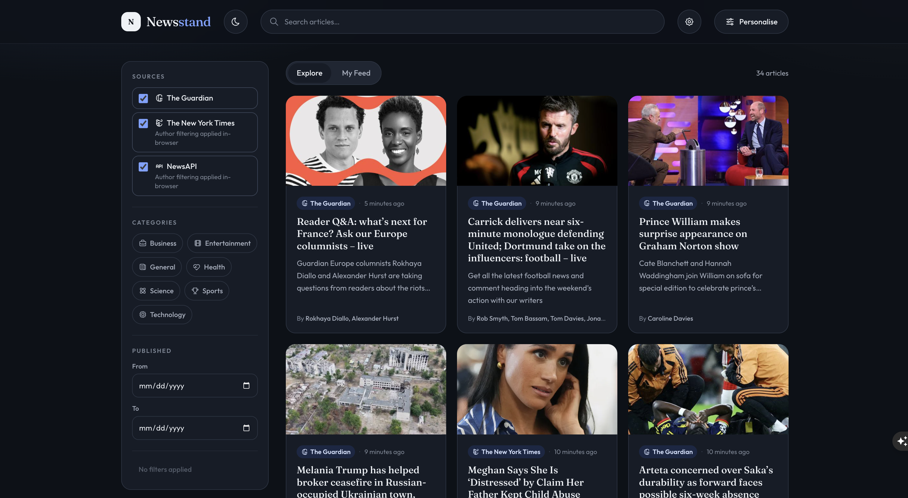
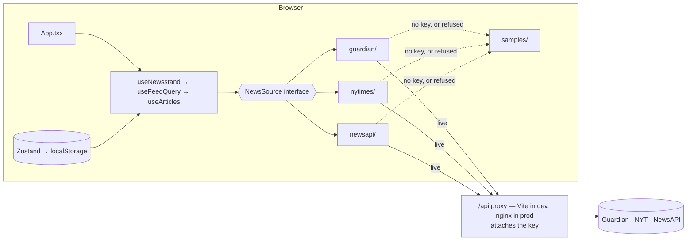

# Newsstand — News Aggregator

A news aggregator built for the innoscripta Frontend Developer case study. It searches and filters
articles across **The Guardian**, **The New York Times** and **NewsAPI.org**, merges them into one
deduplicated feed, and lets a reader personalise that feed by source, category and author.

React 19 · TypeScript (strict) · Vite 8 · TanStack Query · Zustand · Tailwind CSS 4 · nginx

Live: <https://news-aggregator-one-beta.vercel.app/>

<p>
  
  
</p>

|            |                                                                                            |
| ---------- | ------------------------------------------------------------------------------------------ |
| **Live**   | <https://news-aggregator-one-beta.vercel.app/>                                             |
| **Run it** | Put the API keys in `.env.local`, then `docker compose up --build` → <http://localhost:8080> |
| **Keys**   | Server-side only; never in the bundle, never in an image layer                             |
| **Tests**  | 204 across 21 files · 92% statements, 94% lines                                            |
| **Bundle** | 135 kB gzipped JS, 8 kB gzipped CSS · 9 runtime dependencies                               |

---

## Features

**Two feeds, one screen** — **Explore** (search all three providers with filters) and **My Feed**
(only your saved sources, categories and authors).

- **Search** — debounced 400 ms, fanned out to every selected provider in parallel.
- **Filters** — source, category, inclusive date range. Each applied filter is a removable chip
  above the results, with "Clear all".
- **Personalisation** — sources, categories and authors saved to `localStorage` and validated on
  load. Authors can be picked from contributors already in the loaded feed. The three sources
  start selected, so My Feed can open immediately. With no sources, categories, or authors
  selected, it asks for choices instead of fetching.
- **One merged feed** — normalised to a single `Article` model, deduplicated by URL and by headline
  within a 48-hour window, newest first.
- **Browsing** — pages, or infinite scroll that holds your reading position when a newly loaded
  page merges into the middle of the list.
- **Resilience** — a failing provider becomes a notice while the others render; only a total
  failure is an error state. A provider that refuses can fall back to a recorded sample.
- Light / dark / system theme, responsive from 320 px, keyboard accessible.

**Not implemented:** no router or URL state, so a search cannot be shared as a link.

---

## Quick start

```bash
cp .env.example .env.local         # fill in GUARDIAN_KEY, NYT_KEY, and NEWSAPI_KEY
docker compose up --build          # → http://localhost:8080
HOST_PORT=8090 docker compose up --build   # when 8080 is taken
```

Docker reads those keys from `.env.local` when the container starts. Live articles need them, and
they are not baked into the image.

### Local development

Requires **Node 22** (what the Dockerfile and CI use).

```bash
npm install
npm run dev        # http://localhost:5173
```

Scripts: `dev` · `build` · `preview` · `test` · `test:watch` · `lint` · `format`.
Type check and coverage have no script of their own: `npx tsc -b`, `npx vitest run --coverage`.

> `npm run preview` has **no provider proxy** — the upstream table is registered under Vite's
> `server` config, not `preview`. Use Docker to exercise the production path with live data.

---

## Configuration

All three keys are free and self-serve. Put them in `.env.local` (git-ignored) before
`docker compose up`. Docker reads that file at container start.

| Variable       | Where                                                                             | Free tier               |
| -------------- | --------------------------------------------------------------------------------- | ----------------------- |
| `GUARDIAN_KEY` | [open-platform.theguardian.com](https://open-platform.theguardian.com/access/)    | 5,000/day               |
| `NYT_KEY`      | [developer.nytimes.com](https://developer.nytimes.com/) — the key, not the secret | 500/day, **5/min**      |
| `NEWSAPI_KEY`  | [newsapi.org/register](https://newsapi.org/register)                              | **100/day**, 24 h delay |

No `VITE_` prefix anywhere: these are read by the Node dev server and by nginx, never by client
code. The browser only calls same-origin paths — `/api/status` (which keys are set, as booleans),
`/api/guardian/search`, `/api/nyt/articlesearch.json`, `/api/newsapi/{everything,top-headlines}`.
**Anything else under `/api/` returns 404**: each endpoint is matched exactly, because a prefix
match would make the container an open relay for those hosts.

Two reasons for a proxy, not one: **NewsAPI.org sends no CORS headers at all** and allows localhost
origins only, so a deployed page cannot call it directly however the key is handled; and keys stay
server-side.

---

## Architecture



No backend of my own: nginx serves the bundle and proxies the providers; aggregation happens in the
browser. [`useFeedQuery`](src/features/feed/hooks/useFeedQuery.ts) turns UI state into one
`ArticleQuery`. [`useArticles`](src/features/feed/hooks/useArticles.ts) issues **one query per
source per page** — not one combined query — so a failing provider cannot take the others down.
Each [adapter](src/sources) maps its API's response into the canonical `Article`, and
[`mergeFeedResults`](src/features/feed/lib/merge-feed.ts) re-applies any filter a provider could not
honour, then merges, dedupes and sorts.

```
src/
  app/            Composition root only — App, providers, ErrorBoundary
  components/     layout/ (chrome) · ui/ (primitives)
  features/       feed · search · preferences · settings · data-mode
                  each: components/ · hooks/ · lib/
  domain/         Contracts — no React, no fetch
  sources/        registry · transport · demo fallback · one folder per provider
  store/          Persisted preferences, theme, data mode (Zustand)
  hooks/ lib/     Genuinely shared only
```

Dependencies point one way: `app → features → sources → domain`. **Components render, they do not
decide** — anything branching or derived lives in a `hooks/` or `lib/` module with its own tests.
Files are named after what they export: `PascalCase.tsx`, `useCamelCase.ts`, `kebab-case.ts`.

---

## Testing

```bash
npm run test                # 204 tests across 21 files
npx vitest run --coverage   # 92% statements · 94% lines
```

- **Mappers** run against **recorded live API responses**, not hand-written guesses. That caught the
  NYT's `multimedia` being an object of renditions rather than an array, and `response.docs` being
  `null` — not `[]` — on a zero-hit query.
- **Filters are asserted on the results, not just the request.** Selecting a category must remove
  off-category articles from the rendered feed, _including from the provider that cannot filter
  upstream_. Asserting only the outgoing URL cannot tell a provider that filtered from one that
  ignored the filter — and that gap is where two silent bugs lived.
- **The fake honours its parameters.** [`mock-api.ts`](src/test/mock-api.ts) applies each provider's
  real filtering and deliberately ignores `fq`, because the real API does. A fake that returns the
  same page whatever it is asked makes every filter test pass by accident.
- **App tests** (30) drive the whole tree through the real adapters with only `fetch` replaced.

[`.github/workflows/ci.yml`](.github/workflows/ci.yml) runs lint, types, tests and a build on every
push, then builds the image and smoke-tests a **keyless** container.

---

## AI assistance

AI contributed too.
