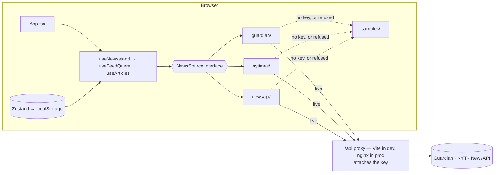

# Newsstand — News Aggregator

A news aggregator built for the innoscripta Frontend Developer case study. It searches and filters
articles across **The Guardian**, **The New York Times** and **NewsAPI.org**, merges them into one
deduplicated feed, and lets a reader personalise that feed by source, category and author.

React 19 · TypeScript (strict) · Vite 8 · TanStack Query · Zustand · Tailwind CSS 4 · nginx

|            |                                                                            |
| ---------- | -------------------------------------------------------------------------- |
| **Run it** | `docker compose up --build` → <http://localhost:8080> — no API keys needed |
| **Keys**   | Server-side only; never in the bundle, never in an image layer             |
| **Tests**  | 204 across 21 files · 92% statements, 94% lines                            |
| **Bundle** | 135 kB gzipped JS, 8 kB gzipped CSS · 9 runtime dependencies               |

---

## Features

**Two feeds, one screen** — **Explore** (search all three providers with filters) and **My Feed**
(only your saved sources, categories and authors).

- **Search** — debounced 400 ms, fanned out to every selected provider in parallel.
- **Filters** — source, category, inclusive date range. Each applied filter is a removable chip
  above the results, with "Clear all".
- **Personalisation** — sources, categories and authors saved to `localStorage` and validated on
  load. Authors can be picked from contributors already in the loaded feed. The three sources
  start selected, so My Feed can open immediately. With no sources, categories, or authors
  selected, it asks for choices instead of fetching.
- **One merged feed** — normalised to a single `Article` model, deduplicated by URL and by headline
  within a 48-hour window, newest first.
- **Browsing** — pages, or infinite scroll that holds your reading position when a newly loaded
  page merges into the middle of the list.
- **Resilience** — a failing provider becomes a notice while the others render; only a total
  failure is an error state. Every provider can fall back to a recorded sample, so the app is fully
  usable with no API keys.
- Light / dark / system theme, responsive from 320 px, keyboard accessible.

**Not implemented:** no router or URL state, so a search cannot be shared as a link.

---

## Quick start

```bash
docker compose up --build          # → http://localhost:8080
HOST_PORT=8090 docker compose up   # when 8080 is taken
```

Without an `.env.local`, every provider serves its recorded sample and a notice above the feed says
so, naming the reason per provider. Everything still works against that sample. For live data:

```bash
cp .env.example .env.local         # fill in the three keys
docker compose up --build
```

Keys are read at **container start**, not build time, so the image holds no credentials.

### Deploy on Vercel

A reviewer can use live articles from a hosted URL without receiving the keys. Set
`GUARDIAN_KEY`, `NYT_KEY`, and `NEWSAPI_KEY` in the Vercel project's environment settings
(Production), then **redeploy** — Vercel binds environment variables at build time, so values
added after the last deploy do not reach the running one:

```bash
npx vercel --prod
```

`api/index.ts` attaches those values on the server. They are not in the repository and not in the
JavaScript bundle. Leave a variable empty to keep that provider on its recorded sample.

Docker does not receive these keys from git. Someone running the container still needs their own
`.env.local`, or they get the samples.

### Local development

Requires **Node 22** (what the Dockerfile and CI use).

```bash
npm install
npm run dev        # http://localhost:5173
```

Scripts: `dev` · `build` · `preview` · `test` · `test:watch` · `lint` · `format`.
Type check and coverage have no script of their own: `npx tsc -b`, `npx vitest run --coverage`.

> `npm run preview` has **no provider proxy** — the upstream table is registered under Vite's
> `server` config, not `preview`. Use Docker to exercise the production path with live data.

---

## Configuration

All three keys are free and self-serve; put them in `.env.local` (git- and Docker-ignored).
**Every key is optional** — a blank one puts that provider on its sample while the others stay live.

| Variable       | Where                                                                             | Free tier               |
| -------------- | --------------------------------------------------------------------------------- | ----------------------- |
| `GUARDIAN_KEY` | [open-platform.theguardian.com](https://open-platform.theguardian.com/access/)    | 5,000/day               |
| `NYT_KEY`      | [developer.nytimes.com](https://developer.nytimes.com/) — the key, not the secret | 500/day, **5/min**      |
| `NEWSAPI_KEY`  | [newsapi.org/register](https://newsapi.org/register)                              | **100/day**, 24 h delay |

No `VITE_` prefix anywhere: these are read by the Node dev server and by nginx, never by client
code. The browser only calls same-origin paths — `/api/status` (which keys are set, as booleans),
`/api/guardian/search`, `/api/nyt/articlesearch.json`, `/api/newsapi/{everything,top-headlines}`.
**Anything else under `/api/` returns 404**: each endpoint is matched exactly, because a prefix
match would make the container an open relay for those hosts.

Two reasons for a proxy, not one: **NewsAPI.org sends no CORS headers at all** and allows localhost
origins only, so a deployed page cannot call it directly however the key is handled; and keys stay
server-side.

---

## Architecture



No backend of my own: nginx serves the bundle and proxies the providers; aggregation happens in the
browser. [`useFeedQuery`](src/features/feed/hooks/useFeedQuery.ts) turns UI state into one
`ArticleQuery`. [`useArticles`](src/features/feed/hooks/useArticles.ts) issues **one query per
source per page** — not one combined query — so a failing provider cannot take the others down.
Each [adapter](src/sources) maps its API's response into the canonical `Article`, and
[`mergeFeedResults`](src/features/feed/lib/merge-feed.ts) re-applies any filter a provider could not
honour, then merges, dedupes and sorts.

```
src/
  app/            Composition root only — App, providers, ErrorBoundary
  components/     layout/ (chrome) · ui/ (primitives)
  features/       feed · search · preferences · settings · data-mode
                  each: components/ · hooks/ · lib/
  domain/         Contracts — no React, no fetch
  sources/        registry · transport · demo fallback · one folder per provider
  store/          Persisted preferences, theme, data mode (Zustand)
  hooks/ lib/     Genuinely shared only
```

Dependencies point one way: `app → features → sources → domain`. **Components render, they do not
decide** — anything branching or derived lives in a `hooks/` or `lib/` module with its own tests.
Files are named after what they export: `PascalCase.tsx`, `useCamelCase.ts`, `kebab-case.ts`.

---

## What I learned about the providers

Only three of the brief's seven sources are usable: NewsAPI is listed twice, OpenNews' API does not
resolve, NewsCred was absorbed into Optimizely, and BBC News has no public API.

**Two of the three cannot apply the filters their documentation advertises, and both fail
silently.** This drives the design.

**The NYT `fq` parameter returns nothing.** Measured live with a valid key, same minute, HTTP 200
throughout:

```
q=climate                              →  10,000 hits
q=climate & fq=news_desk:("Climate")   →       0 hits, docs: null
fq=document_type:("article")           →       0 hits   (trivially true filter)
fq=glocations:("Iraq")                 →       0 hits   (NYT's own documentation example)
```

Any `fq` empties the result set, so the adapter does not send it: the NYT declares
`categoryFilter: false` and `authorFilter: false`, and those are applied in the browser instead.

**NewsAPI splits filters across two incompatible endpoints.** `/everything` has no category
parameter; `/top-headlines` silently ignores dates. So a keyword cannot decide the endpoint — if a
category is selected the request goes to `/top-headlines` and the keyword rides along. A narrower
corpus, but a narrow correct result beats a broad wrong one.

This is why `capabilities(query)` **takes the query**: for two providers the honest answer depends
on what else was asked for. Every `false` is enforced by `mergeFeedResults`, so the flags are
behaviour, not documentation — a test asserts the NYT stops contributing off-category articles.

---

## Key decisions

- **Rate limits shaped the caching.** The NYT allows 5 requests/min and NewsAPI 100/day, so: search
  is debounced, `staleTime` is 5 min with no refetch on focus, 4xx is never retried, and nginx
  caches responses for 5 min with the credential excluded from the key — shared across tabs and
  readers rather than per-session.
- **Infinite scroll is not a second data path.** It asks for pages 1…N instead of N; all but the
  newest are already cached, so the list is derived from the cache with no accumulator to drift.
- **Untrusted input is validated.** `localStorage` can be hand-edited, and an unknown source id
  there would reach `getSource`, which throws — blanking the page before first render.
  `sanitizePreferences` narrows it field by field. An `ErrorBoundary` catches the rest.
- **No hidden module state.** Which providers are refusing lives in the store and reaches the
  transport through `FetchContext`; how a page was delivered is returned with it. `sources/` reads
  no store and no environment.
- **Every feed state is modelled** — skeletons, per-provider failure notices, a distinct all-failed
  state, prompts for "no sources" and "nothing personalised", a page cap. Failures are classified
  once in the transport into `rate-limited | auth | network | unknown`.

---

## Testing

```bash
npm run test                # 204 tests across 21 files
npx vitest run --coverage   # 92% statements · 94% lines
```

- **Mappers** run against **recorded live API responses**, not hand-written guesses. That caught the
  NYT's `multimedia` being an object of renditions rather than an array, and `response.docs` being
  `null` — not `[]` — on a zero-hit query.
- **Filters are asserted on the results, not just the request.** Selecting a category must remove
  off-category articles from the rendered feed, _including from the provider that cannot filter
  upstream_. Asserting only the outgoing URL cannot tell a provider that filtered from one that
  ignored the filter — and that gap is where two silent bugs lived.
- **The fake honours its parameters.** [`mock-api.ts`](src/test/mock-api.ts) applies each provider's
  real filtering and deliberately ignores `fq`, because the real API does. A fake that returns the
  same page whatever it is asked makes every filter test pass by accident.
- **App tests** (30) drive the whole tree through the real adapters with only `fetch` replaced.

[`.github/workflows/ci.yml`](.github/workflows/ci.yml) runs lint, types, tests and a build on every
push, then builds the image and smoke-tests a **keyless** container.

---

## Limitations

- **No URL state or router** — a search cannot be shared and Back does not step through filters. The
  largest remaining gap; it would be `URLSearchParams` + `history` in `useFeedQuery`, not a routing
  library, since there is one screen.
- **Responses are typed, not schema-validated.** The adapters are defensive, but nothing parses
  provider payloads at runtime. For production I would validate them.
- **The NYT cannot filter by category or author** on the free tier, so those narrow the ten
  documents that page returned rather than searching the archive.
- **NewsAPI returns one category per request** (the UI says which) and its articles are up to 24 h
  old, so they sort below the other two.
- **Pagination is per-source**, so a merged page can hold fewer than `pageSize × sources` articles.
  A strict global order would need a k-way merge.
- **Preferences are per browser** — no accounts, no sync, no cross-tab updates until reload.
- **No end-to-end tests.** The App suite covers most of what a browser test would, but not real
  layout or the pre-paint theme script.
- **Free tiers are development-only** — NewsAPI's plan forbids staging and production use.

---

## Troubleshooting

| Symptom                                    | Fix                                                         |
| ------------------------------------------ | ----------------------------------------------------------- |
| `Bind for 0.0.0.0:8080 failed`             | `HOST_PORT=8090 docker compose up --build`                  |
| Everything says "sample articles"          | No keys — check `/api/status`, then fill `.env.local`       |
| A provider rejects the key                 | The NYT issues a key _and_ a secret; this needs the **key** |
| Live data works in `dev` but not `preview` | Preview has no provider proxy — use Docker                  |

---

## AI assistance

AI was used as a pair-programming tool here, and it seems more useful to say how than to leave it
implied.

**What it did** — drafted implementation code, tests and configuration from specifications I set,
carried out mechanical refactors, and produced first drafts of this README. It was also used as a
reviewer: several fixes came from an adversarial review pass rather than from writing new code,
including unvalidated `localStorage` reaching `getSource()`, a missing error boundary, and a Docker
image that would not boot without API keys.

**What stayed with me** — scope and architecture: the `NewsSource` port, capabilities-as-a-function,
aggregating in the browser rather than adding a backend, and what to leave out. Every change was
reviewed before it landed.

**What was verified rather than trusted** — the provider behaviour above is the important case. The
NYT `fq` results and NewsAPI's endpoint split are **measured against the live APIs**, not taken from
a model's description of them, because a plausible-sounding wrong answer about an API is exactly the
failure mode here. The mappers are tested against recorded real responses for the same reason. Every
command in this README was run against this tree.
